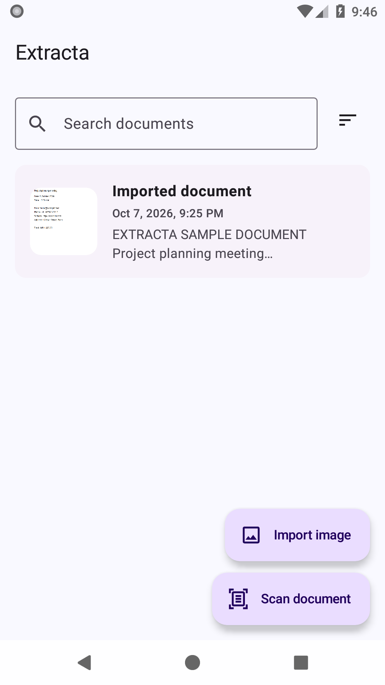
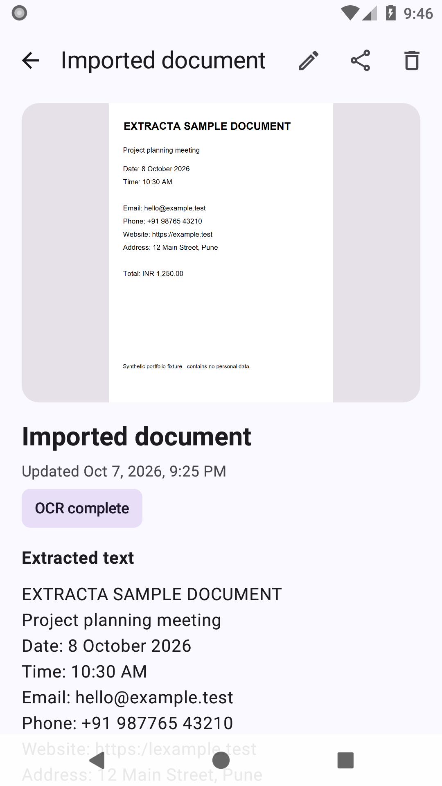
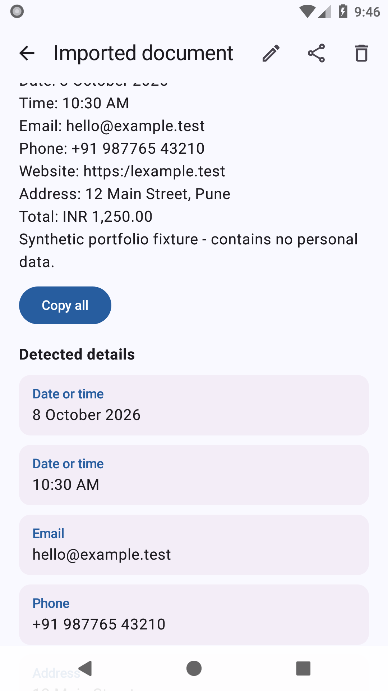

# Extracta

Extracta is an offline-first Android document scanner built with Kotlin and Jetpack Compose. It captures or imports an image, recognizes printed text on-device, detects useful entities, and opens safe Android actions—all without accounts, cloud storage, a backend, or an internet connection.

## Screenshots

All screenshots use synthetic data.

<p align="center">
  
  
  
</p>

## Highlights

- Capture documents with CameraX or import an image through the system photo picker.
- Run bundled ML Kit Latin text recognition entirely on-device.
- Detect email addresses, URLs, phone numbers, dates, times, money, and street addresses with a deterministic parser.
- Open contextual actions such as dial, email, browser, maps, and calendar, with copy as a safe fallback.
- Search titles and OCR text, sort documents, rename them, delete them with confirmation, and share text or images.
- Persist documents, OCR state, and detected entities in Room with an explicit schema migration.
- Recover interrupted OCR work and retain search/sort state across recreation.
- Decode bounded thumbnails and previews to avoid loading full-resolution images into the UI.
- Keep document images in app-private storage and disable cloud backup, device transfer, and cleartext traffic.
- Support light, dark, and dynamic color themes with accessibility-oriented Compose semantics.

## Architecture

```text
Compose screen
    -> screen ViewModel
        -> repository interface
            -> Room repository + app-private image storage

capture/import
    -> durable document in Room
        -> application-scoped OCR processor
            -> bundled ML Kit recognizer
                -> deterministic entity processor
                    -> transactional entity persistence
                        -> searchable Details UI and Android actions
```

The project is intentionally a single Android application module. UI features are grouped by screen, while persistence, OCR, entity extraction, domain models, dependency injection, and navigation have focused packages. ViewModels expose immutable UI state and depend on repository interfaces rather than Android persistence details.

## Tech stack

- Kotlin 2.0 and Java 17
- Jetpack Compose and Material 3
- CameraX
- Bundled ML Kit Text Recognition
- Room with KSP schema generation and migration tests
- Hilt dependency injection
- Kotlin Coroutines and Flow
- Coil image loading
- JUnit and Compose UI testing
- Gradle 8.7 and Android Gradle Plugin 8.6

The app targets Android API 35 and supports Android 8.0 (API 26) and newer.

## Privacy and offline behavior

Extracta does not require an account or network service. Imported and captured images are copied into app-private storage, OCR runs using the bundled on-device model, and extracted data stays in the local Room database. Android backup and device-to-device transfer are disabled for document data.

External apps are opened only after an explicit user action. Intent targets are resolved before launch, URI components are encoded, and shared images are exposed through a restricted `FileProvider` grant.

## Testing

The project contains:

- 48 JVM tests covering repositories, mapping, ViewModels, OCR orchestration, extraction rules, normalization, overlap handling, URI generation, and recovery behavior.
- 34 instrumentation tests covering Room and migrations, Compose UI states, Camera UI, bundled OCR, sharing, actions, accessibility semantics, activity recreation, and large-image decoding.
- Android lint plus debug APK, minified release APK, and release AAB builds in GitHub Actions.

The connected suite has been exercised on Android API 26 and API 35.

## Build locally

Prerequisites:

- Android Studio with Android SDK 35
- JDK 17

Clone the repository and build the debug APK:

```powershell
git clone https://github.com/Pratham-Shrivastava379/Extracta.git
cd extracta
.\gradlew.bat :app:assembleDebug
```

On macOS or Linux, use `./gradlew` instead of `.\gradlew.bat`.

Run JVM tests and lint:

```powershell
.\gradlew.bat :app:testDebugUnitTest :app:lintDebug --no-daemon
```

With an emulator or device connected, run instrumentation tests:

```powershell
.\gradlew.bat :app:connectedDebugAndroidTest --no-daemon
```

Release builds are minified and resource-shrunk. Production signing is supplied externally so credentials never enter source control; see [the release guide](docs/RELEASE.md).

## Current limitations

- OCR is optimized for clearly framed, printed Latin-script text.
- Handwriting, multi-page scanning, automatic cropping, perspective correction, and PDF export are not currently supported.
- Entity extraction is intentionally conservative and may reject ambiguous locale-specific values.
- New captures and imports receive a generic title until renamed.

## Project status

The portfolio MVP is feature-complete and its automated build, lint, and test suites pass. Remaining publication work is limited to human accessibility review, production signing, and store-distribution checks.
